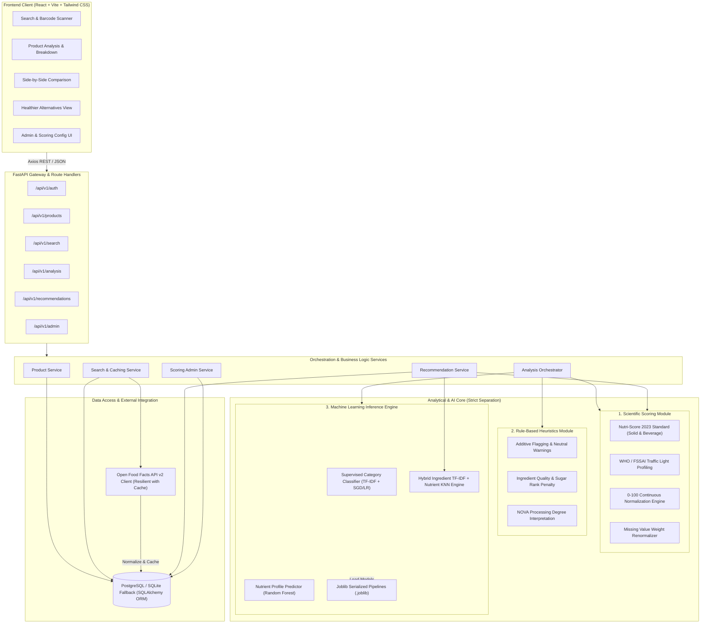

# 01. System Architecture

## 1. High-Level Architectural Overview

The **Smart Shopping Assistant (SSA)** is designed as an enterprise-grade, modular monorepo tailored for academic rigor and local reproducibility. The system enforces strict separation of concerns across presentation, business orchestration, scientific computation, machine learning inference, and normalized persistence.



---

## 2. Architectural Layers & Boundaries

### 2.1 Presentation Layer (Frontend)
- **Technology**: Single Page Application (SPA) built with React 18, Vite, and Tailwind CSS.
- **State & Data Fetching**: Centralized Axios client configured with JWT interceptors, loading states, and structured error notifications.
- **Visual Analytics**: Interactive data visualizations using Recharts (radial charts for 0–100 overall score, radar charts for multi-nutrient balance, and stacked bar charts for comparison).
- **Core Principle**: UI explicitly delineates between **Scientific Score**, **Project Heuristics**, and **Machine Learning Insights** to guarantee epistemological transparency.

### 2.2 API & Ingress Layer (FastAPI)
- **Role**: Validates input payloads, enforces HTTP protocols, checks JWT authentication, handles rate limits, and delegates directly to the Service Layer.
- **Invariant**: **Zero ML or scoring calculation logic resides in route files**. All endpoints act strictly as thin controllers.

### 2.3 Service Orchestration Layer
- **Role**: Coordinates workflows across databases, external APIs, and the scoring/ML engines.
- **Search Strategy Workflow**:
  ```mermaid
  sequenceDiagram
      autonumber
      actor User as Frontend Client
      participant Svc as Search Service
      participant DB as Local Database (PostgreSQL/SQLite)
      participant OFF as Open Food Facts API v2
      participant Score as Scoring & ML Engines

      User->>Svc: GET /api/v1/search/barcode/{barcode}
      Svc->>Svc: Validate Barcode (GTIN-8/12/13/14 + Check Digit)
      Svc->>DB: Query Product by Barcode
      alt Product Found in Local Database
          DB-->>Svc: Return Normalized Product & Nutrition
      else Product Not Found Locally
          Svc->>OFF: GET /api/v2/product/{barcode}.json
          alt Found on Open Food Facts
              OFF-->>Svc: Raw OFF JSON Response
              Svc->>Svc: Clean, Normalize & Map to Schema
              Svc->>DB: Persist Product, Nutrients & Ingredients
              DB-->>Svc: Saved Product Entity
          else Not Found or Timeout
              OFF-->>Svc: 404 Not Found / HTTP Timeout
              Svc-->>User: Structured 404 / 503 Friendly Message
          end
      end
      Svc->>Score: Compute Scores & Recommendations
      Score-->>Svc: Analytical Result Envelope
      Svc-->>User: Complete JSON Response
  ```

### 2.4 Analytical & AI Core (Triple-Engine Architecture)
To ensure full academic integrity, the analytical core is divided into three completely distinct sub-packages:
1. **Scientific Scoring Engine (`app/scoring/scientific`)**:
   - Implements the official **Nutri-Score 2023** algorithm for both Solid Foods (per 100g) and Beverages (per 100ml).
   - Generates the continuous 0–100 Project Health Index using mathematically defined saturating non-linear normalization functions.
   - Implements dynamic weight renormalization when nutrient parameters are missing (`None`).
2. **Rule-Based Heuristics Engine (`app/scoring/rules`)**:
   - Scans ingredient lists for food additives (E-numbers / INS numbers) and generates neutral informational flags (e.g., "Contains Artificial Sweetener E950").
   - Evaluates ingredient transparency, whole-grain indicators, and sugar hierarchy ranking.
3. **Machine Learning Engine (`app/ml`)**:
   - Supervised classification models for automatic category prediction.
   - Vector similarity models (TF-IDF cosine similarity) combined with nutrient-vector KNN for high-precision alternative recommendations.
   - Pre-trained models loaded from static `.joblib` artifacts via a singleton lifecycle manager; training code lives strictly in `/ml`.

### 2.5 Data Persistence Layer (Database)
- **Primary**: PostgreSQL managed via Docker Compose for production-like relational durability.
- **Dev/Demo Fallback**: Fully supported SQLite via connection string in `.env` (`DATABASE_URL=sqlite:///./smart_shopping.db`) allowing instant standalone offline execution on Windows.
- **Schema Management**: Alembic migration scripts maintaining normalized relational integrity.

---

## 3. Data Flow & Security Model

### 3.1 Security & Authentication
- **Password Hashing**: Passwords stored using `bcrypt` / `passlib` with salt.
- **Token Authorization**: Stateless JWT tokens (HMAC-SHA256) with standard expiry; role-based access control (Admin vs Standard User).
- **Protection**: CORS middleware restricted to designated frontend origins; rate limiting on search and external lookups.

### 3.2 Offline First & Academic Demonstration Readiness
- The application incorporates a complete seed script (`seed_data.py`) with pre-normalized Indian and international food and beverage products across diverse categories (e.g., breakfast cereals, carbonated beverages, dairy, snacks, plant-based milks).
- This ensures 100% offline demonstrability during project viva/evaluations even if internet connectivity or Open Food Facts is unavailable.
