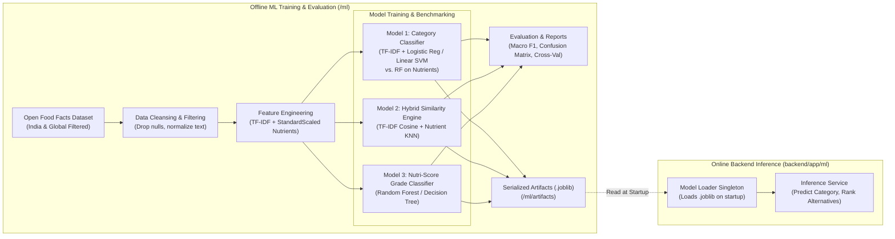

# 04. Machine Learning Implementation Strategy

## 1. Machine Learning Philosophy & Academic Boundaries

To uphold academic integrity and transparency for this MCA project, the ML architecture enforces strict scientific boundaries:
- **No Pseudo-ML**: Weighted formulas, deterministic heuristic equations, and rule-based additive flags are strictly separated and never labeled as "AI" or "ML".
- **Real Supervised & Unsupervised Models**: Every machine learning model in this system is an actual statistical model built with `scikit-learn`, trained on verified Open Food Facts datasets, rigorously evaluated with cross-validation and standard metrics (Accuracy, Macro-F1, Precision, Recall, Confusion Matrix), serialized using `joblib`, and loaded as static artifacts by the backend inference engine.
- **Explainability**: Machine learning outputs provide interpretable feature contributions (e.g., TF-IDF top informative tokens, feature importances for tree-based models, and cosine distance breakdowns).

---

## 2. Machine Learning System Architecture

---

## 3. Dataset Collection & Preprocessing

### 3.1 Data Source & Acquisition
- **Primary Source**: Open Food Facts public data export filtered to products marketed in India and major global categories (cereals, beverages, dairy, snacks, condiments).
- **Target Size**: Curated corpus of 10,000+ clean records for robust offline training, supplemented with a representative 500+ record sample embedded directly in the repository for immediate offline evaluation and test verification.
- **Inclusion Criteria**:
  - Valid barcode and complete product title.
  - Complete mandatory nutrient declaration (Energy, Fat, Saturated Fat, Carbohydrates, Sugars, Proteins, Salt/Sodium).
  - Explicit ingredient text or tag list.
  - Category mapping to one of 10 standardized taxonomy classes.

### 3.2 Preprocessing & Feature Extraction
1. **Text Preprocessing**:
   - Tokenization and lowercasing.
   - Removal of punctuation, numbers, and standard English/Hindi packaging stop words (e.g., "net", "weight", "pack", "gm", "ml", "best", "before").
   - Word and n-gram extraction (unigrams + bigrams: `ngram_range=(1, 2)`).
   - Frequency filtering (`min_df=3`, `max_df=0.85`).
2. **Nutritional Vector Scaling**:
   - Continuous numerical features: `[energy_kcal, sugars_g, sodium_mg, saturated_fat_g, proteins_g, fiber_g]`.
   - Missing values in training sets are either pruned or imputed using median values per category.
   - Standardized using `StandardScaler` (zero mean, unit variance) fitted on the training split only to prevent data leakage.

---

## 4. Model 1: Product Category Classification

### 4.1 Objective & Target Taxonomy
Predicts the standard food or beverage category when missing or unstandardized in barcode metadata. Target classes (10 distinct categories):
1. `breakfast_cereals`
2. `carbonated_beverages`
3. `fruit_juices_and_drinks`
4. `dairy_and_plant_milks`
5. `biscuits_and_cookies`
6. `savory_snacks_and_chips`
7. `chocolates_and_confectionery`
8. `breads_and_bakery`
9. `sauces_and_condiments`
10. `instant_noodles_and_pasta`

### 4.2 Candidate Models & Comparative Evaluation
We train and benchmark two distinct architectural pipelines:
1. **Text-Based Pipeline (NLP)**:
   - **Vectorizer**: TF-IDF on concatenated `product_name + " " + ingredients_text`.
   - **Classifiers**: Multinomial Naive Bayes, Linear Support Vector Classifier (LinearSVC), and Logistic Regression (L2 regularization).
2. **Nutrient-Based Pipeline (Tabular)**:
   - **Features**: Scaled 6-dimensional nutrient vector.
   - **Classifier**: Random Forest Classifier (100 trees, max depth 12).

### 4.3 Evaluation Metrics
- **Dataset Split**: 80% Train, 20% Test (stratified by category).
- **Cross-Validation**: 5-Fold Stratified Cross-Validation on the training set.
- **Reported Metrics**: Accuracy, Macro-Averaged Precision, Recall, Macro-F1 score, and a confusion matrix heatmap.
- **Feature Importance**: Top 15 most informative TF-IDF tokens per category (via logistic regression model coefficients) and Gini feature importances for the Random Forest baseline.

---

## 5. Model 2: Hybrid Content Similarity & Alternative Ranking Engine

### 5.1 Objective
Identifies healthier alternative food and beverage products within the same functional category. A valid alternative must be functionally similar to the original product so the consumer can realistically substitute it (e.g., recommending an oat-based cereal for a sugary cornflake, rather than recommending mineral water for a cookie).

### 5.2 Hybrid Similarity Formulation
The similarity metric $S(A, B) \in [0, 1]$ between target product $A$ and candidate alternative $B$ combines semantic ingredient similarity and nutritional proximity:

$$S(A, B) = \alpha \cdot S_{\text{text}}(A, B) + (1 - \alpha) \cdot S_{\text{nutrient}}(A, B)$$

Where:
1. **Text / Ingredient Cosine Similarity ($S_{\text{text}}$)**:
   - Computed via Cosine Similarity over sparse TF-IDF vectors of standardized ingredient lists:
     $$S_{\text{text}}(A, B) = \frac{\mathbf{v}_A \cdot \mathbf{v}_B}{\|\mathbf{v}_A\| \|\mathbf{v}_B\|}$$
2. **Nutrient-Space Proximity ($S_{\text{nutrient}}$)**:
   - Computed using Euclidean distance over the StandardScaled nutrient vectors $\mathbf{u}_A, \mathbf{u}_B \in \mathbb{R}^6$:
     $$D_{\text{nutrient}}(A, B) = \|\mathbf{u}_A - \mathbf{u}_B\|_2$$
     $$S_{\text{nutrient}}(A, B) = \frac{1}{1 + D_{\text{nutrient}}(A, B)}$$
3. **Weight Parameter**: $\alpha = 0.60$ (prioritizing ingredient and functional equivalence while ensuring nutritional profile relevance).

### 5.3 Multi-Criteria Final Recommendation Ranking
Once candidates with category match and minimum data completeness are selected, the final ranking score $R(B | A) \in [0, 1]$ is computed as a transparent, documented combination rule:

$$R(B | A) = w_1 \cdot S(A, B) + w_2 \cdot \Delta_{\text{score}}(B, A) + w_3 \cdot \text{Score}_{\text{norm}}(B)$$

Where:
- $S(A, B)$ is the hybrid similarity score ($w_1 = 0.40$).
- $\Delta_{\text{score}}(B, A) = \max\left(0, \frac{\text{Score}(B) - \text{Score}(A)}{100}\right)$ is the normalized project score improvement ($w_2 = 0.35$).
- $\text{Score}_{\text{norm}}(B) = \frac{\text{Score}(B)}{100}$ is the baseline quality score of the alternative ($w_3 = 0.25$).
- **Rule**: If $\text{Score}(B) \le \text{Score}(A)$, the candidate is disqualified from the recommendations list.

---

## 6. Model 3 (Optional / Benchmark): Nutri-Score Grade Classifier

### 6.1 Objective
To demonstrate ML interpretability, a supervised multiclass classifier (Random Forest / Decision Tree) is trained on raw nutrient values to predict the official computed Nutri-Score grade (A, B, C, D, E).

### 6.2 Analytical Purpose
- **Validation**: Compare ML-derived boundaries with the deterministic mathematical cut-offs of Nutri-Score 2023.
- **Explainability**: Extract Gini feature importances and Tree SHAP values to visualize which nutritional parameters contribute most heavily to an unhealthy versus healthy grade.
- **Evaluation**: Report classification report and multiclass confusion matrix against the true mathematical label.

---

## 7. Model Persistence, Artifacts & Runtime Serving

### 7.1 Serialization Specification
All trained models, vectorizers, and scalers are saved in `/ml/artifacts/` using `joblib` with version metadata:
- `category_classifier_tfidf_logreg.joblib`
- `category_tfidf_vectorizer.joblib`
- `nutrient_scaler.joblib`
- `nutri_score_rf_classifier.joblib`
- `model_metadata.json` (records training date, sample size, cross-validation scores, and git commit hash).

### 7.2 Backend Runtime Loading (`app/ml/model_loader.py`)
- Models are loaded into memory once during FastAPI application startup via lifespan events (`@asynccontextmanager`).
- Thread-safe, read-only inference functions wrapped in clean Python service classes.
- Zero training code or data science dependencies (like matplotlib/seaborn) required inside the FastAPI production container.
