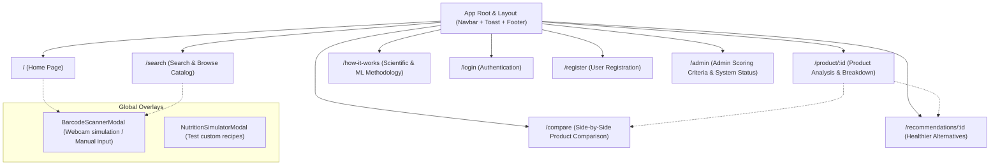

# 07. Frontend Page & Component Structure

## 1. Frontend Technology Stack & Philosophy

The user interface of the **Smart Shopping Assistant** is developed with **React 18**, **Vite**, and **Tailwind CSS**, designed for fluid desktop and tablet interactions. 

### Core Scientific Design Tenet
To avoid consumer confusion and maintain academic honesty:
- **Scientific Reference (Nutri-Score)** is displayed using the standardized official 5-color badge system (A–E).
- **Proposed Project Score (0–100)** is rendered in a continuous circular gauge labeled *"Project Health Index (Proposed Research Framework)"*.
- **Rule-Based Flags** (NOVA processing, additive notices) are styled as neutral informational tags with alert icons.
- **Machine Learning Outputs** (Similarity percentage, Category classification confidence) are highlighted with distinctive AI/ML badge tags to indicate statistical inference rather than hard rules.

---

## 2. Page Hierarchy & Routing Structure



---

## 3. Detailed Page Breakdown & User Flows

### 3.1 Home Page (`/`)
- **Hero Section**: Catchy title, value proposition, and an omnipresent search input supporting barcode input or text queries.
- **Barcode Scanner Trigger Button**: Opens the `BarcodeScannerModal` with live preview and demo barcode quick-select buttons.
- **Quick Category Cards**: 8 popular categories (Breakfast Cereals, Juices, Dairy, Snacks, Sodas, etc.) with instant filter shortcuts.
- **Feature Highlights**: Explanations of why independent analysis is essential (misleading front-of-pack claims, hidden sugars).

### 3.2 Product Search & Catalog Page (`/search`)
- **Search Header**: Query input, category filter dropdown, product type toggle (All, Solid Food, Beverages), and sorting options (Overall Score: High to Low, Sugar: Low to High, Data Completeness).
- **Active Filter Chips**: Removeable filter pills for quick adjustments.
- **Product Grid**: Rendered using responsive `ProductCard` components showing:
  - Product thumbnail, brand, and name.
  - Official Nutri-Score badge (A–E).
  - Project Score pill (0–100) with color-coded band.
  - NOVA group badge (1–4).
  - Quick action buttons ("Analyze", "Find Alternatives", "Add to Compare").

### 3.3 Product Analysis & Scientific Breakdown Page (`/product/:id`)
This is the core flagship view of the application, structured into five clean visual cards:
1. **Header Card**: Product image, brand, validated barcode, category tag, serving size, and data completeness indicator bar.
2. **Dual-Score Showcase**:
   - *Left*: Official Nutri-Score 2023 Grade (large five-segment banner with active letter callout).
   - *Right*: Proposed Project Score Circular Gauge (0–100 score, health band, confidence score).
3. **Nutrient Sub-Score Radar & Bar Charts (Recharts)**:
   - Interactive bar chart showing sub-scores for Sugars, Sodium, Saturated Fat, Energy, Protein, and Fiber.
   - Traffic light color coding (Green: Healthy, Amber: Moderate, Red: High concern).
4. **Pros & Cons Data-Derived Explanations**:
   - Distinct green checkmark list of data-backed positive attributes.
   - Amber/Red warning list of excess nutrients with exact measured amounts and regulatory reference cut-offs.
5. **Ingredient Quality & Additive Registry**:
   - Order-preserved ingredient pill list.
   - Sugar hierarchy warning if sugar is among the top 3 ingredients.
   - Table of identified additives with neutral INS/E-number descriptions.
6. **Action Bar**: Direct button to view *"Healthier Alternatives"* and *"Add to Comparison"*.

### 3.4 Healthier Alternatives & Recommendations Page (`/recommendations/:id`)
- **Target Product Summary Banner**: Shows the original product being replaced, its overall score, and primary nutritional deficits (e.g., "High Sugar: 24g").
- **Alternative Candidate Cards**: Ranked strictly by the multi-criteria formula:
  - **Match Badge**: Hybrid Similarity percentage (e.g., "88% Ingredient & Category Match").
  - **Score Improvement Callout**: "+22 Pts Healthier" badge.
  - **Per-Parameter Differential Indicators**:
    - $\downarrow$ 45% Less Sugar (-10.8g)
    - $\uparrow$ 80% More Fiber (+3.2g)
    - $\downarrow$ 30% Less Sodium (-120mg)
  - Clear rationale text: *"Replaces refined wheat flour and sugar with whole oats and honey, reducing total sugar by 45% while doubling dietary fiber."*

### 3.5 Side-by-Side Product Comparison Page (`/compare`)
- **Comparison Tray**: Persistent bottom drawer or top selector holding 2 to 4 active products.
- **Radar Chart Overlay**: Multi-axis radar chart mapping normalized nutrient concentrations across all compared items.
- **Nutritional Matrix Table**: Side-by-side comparison of:
  - Serving size, Energy (kcal), Sugars, Saturated Fat, Sodium, Fiber, Protein.
  - Nutri-Score grade and Proposed Project Score.
  - Highlighting best-in-class values with subtle green callouts.

### 3.6 How It Works & Methodology Page (`/how-it-works`)
- Interactive academic guide explaining:
  - The Nutri-Score 2023 revision (Solid vs Beverage formula).
  - The Project 0–100 continuous scoring equations and normalization curves.
  - The missing data weight renormalization technique.
  - The machine learning category classification and hybrid similarity engine.

### 3.7 Admin Dashboard (`/admin`)
- **Protected View** (Requires Admin JWT):
  - **Scoring Criteria Editor**: Data table listing all rows from `scoring_criteria` (Solid vs Beverage thresholds and weights). Allows inline editing and immediate saving.
  - **Catalog Overview**: Total products, breakdown by category, and data completeness metrics.
  - **System Diagnostics**: Health check of database connection, local disk cache, and loaded ML models.

---

## 4. Reusable Component Library

```text
frontend/src/components/
├── common/
│   ├── Navbar.tsx                   # Top navigation with search shortcut and auth links
│   ├── Footer.tsx                   # Academic project credit, disclaimer, github link
│   ├── Modal.tsx                    # Accessible backdrop dialog wrapper
│   ├── Badge.tsx                    # Tailwind pill badges (Green, Amber, Red, Purple)
│   └── LoadingSpinner.tsx           # Polished animated loading state
├── search/
│   ├── SearchBar.tsx                # Auto-suggest search input with barcode button
│   ├── BarcodeScannerModal.tsx      # Video / Camera scanner with mock barcode quick-list
│   └── FilterSidebar.tsx            # Category, solid/beverage, and score filters
├── product/
│   ├── ProductCard.tsx              # Card representation in catalog & search
│   ├── NutritionTable.tsx           # Standardized FDA/FSSAI-style facts panel
│   └── IngredientList.tsx           # Highlighted tokenized ingredient pills
├── scoring/
│   ├── NutriScoreBanner.tsx         # Official 5-color Nutri-Score A-B-C-D-E graphic
│   ├── ScoreGauge.tsx               # Recharts radial bar gauge for 0-100 score
│   ├── SubScoreBarChart.tsx         # Horizontal parameter score breakdown
│   └── NovaBadge.tsx                # Official NOVA 1-4 classification badge
├── recommendation/
│   ├── AlternativeCard.tsx          # Card with parameter improvement delta chips
│   └── ImprovementChip.tsx          # Green/Red pill showing exact numerical delta
├── comparison/
│   ├── ComparisonMatrix.tsx         # Side-by-side table component
│   └── ComparisonRadar.tsx          # Recharts radar chart comparing nutrients
└── admin/
    ├── CriteriaTable.tsx            # Editable threshold and weight table
    └── SystemStatusCard.tsx         # Model and database health monitor
```

---

## 5. State Management & API Integration Layer

- **Authentication State (`context/AuthContext.tsx`)**: Stores JWT token in `localStorage`, decodes token claims, manages login/logout, and provides `useAuth()` hook.
- **Comparison State (`context/ComparisonContext.tsx`)**: Manages selected products for side-by-side comparison across navigation transitions.
- **HTTP Client (`api/axiosClient.ts`)**:
  - Automatically attaches `Authorization: Bearer <token>` when available.
  - Global response interceptor catching `401 Unauthorized` (triggers logout) and `503 Service Unavailable` (triggers user-friendly alert toast).
